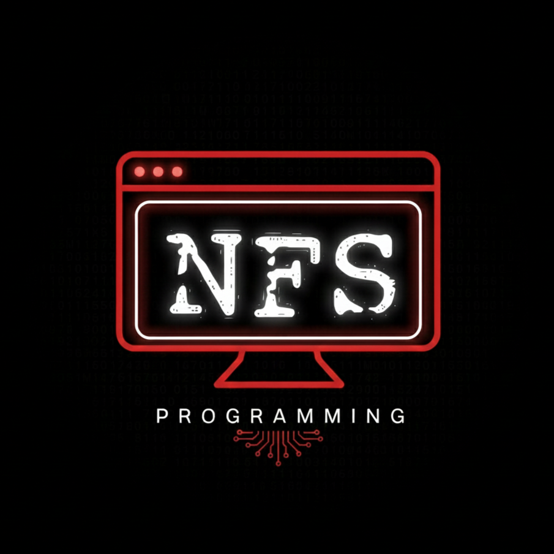

<div align="center">



# NFS Learning Hub

**A unified, interactive learning portal featuring curated official open-source Microsoft curricula for Web Development, AI, Machine Learning, Data Science, and Cloud Architecture.**

[](LICENSE)
[](https://nfs-learning-hub.vercel.app)
[](https://github.com/microsoft)
[](https://github.com/nfsprogramming/NFS-Learning-Hub)

</div>

---

## Overview

**NFS Learning Hub** is an all-in-one educational web application and offline learning environment designed to make Microsoft's official, open-source curricula accessible, interactive, and structured. 

Instead of navigating fragmented GitHub repositories or raw markdown files, learners experience an integrated, premium interface complete with real-time markdown rendering, interactive diagramming, notebook deep-linking, module search, and progress tracking.

---

## Curated Courses & Modules

The platform organizes 13 comprehensive courses into four progressive mastery tiers:

### 1. Beginner Level
- **Web Development for Beginners** (`web-dev-for-beginners`) — 24 lessons covering HTML, CSS, JavaScript, browser extensions, and web APIs.
- **Machine Learning for Beginners** (`ml-for-beginners`) — 26 lessons covering core ML concepts, regression, classification, clustering, and NLP with Scikit-learn.
- **Data Science for Beginners** (`data-science-for-beginners`) — 20 lessons focusing on Python, Pandas, data preparation, and visualization.
- **AI for Beginners** (`ai-for-beginners`) — 24 lessons exploring neural networks, computer vision, natural language processing, and symbolic AI.

### 2. Intermediate Level
- **Generative AI for Beginners** (`generative-ai-for-beginners`) — 18 lessons on LLMs, prompt engineering, Retrieval-Augmented Generation (RAG), and vector databases.
- **AI Agents for Beginners** (`ai-agents-for-beginners`) — 15 lessons exploring AutoGen, multi-agent coordination, and browser automation.
- **GitHub Copilot Developer Guide** (`mslearn-github-copilot-dev`) — 10 lessons on prompt crafting, test generation, and AI-assisted engineering.

### 3. Advanced Level
- **IoT for Beginners** (`iot-for-beginners`) — 24 lessons on sensors, microcontrollers, edge computing, and cloud telemetry.
- **AI-102 Azure AI Engineer** (`ai-102-ai-engineer`) — Certification-aligned labs for Azure Cognitive Services, Computer Vision, Speech, and Azure OpenAI.
- **Azure AI Studio** (`mslearn-ai-studio`) — Hands-on enterprise copilots, evaluation pipelines, and Azure AI Foundry.
- **Microsoft AI Architectures** (`ai-architectures`) — Enterprise-grade reference architectures and production patterns.

### 4. Industry & Production
- **AI Deployment in Production** (`deploy-your-ai-application-in-production`) — MLOps, containerization with Docker, CI/CD, and model monitoring.
- **Responsible AI Toolbox** (`responsible-ai-toolbox`) — Enterprise toolkits for fairness assessment, interpretability, error analysis, and mitigating bias.

---

## Features

- **Integrated Course Viewer**: Custom sidebar navigation for all lessons and modules with automatic path resolution.
- **Rich Document Rendering**: Client-side Markdown rendering powered by `Marked.js` and sanitized with `DOMPurify`.
- **Dynamic Mermaid.js Diagrams**: Interactive visual rendering of architectural and flow diagrams directly within lesson notes.
- **Jupyter Notebook Integration**: Quick links to open `.ipynb` exercises locally or via Google Colab and GitHub.
- **Real-Time Module Search**: Instant client-side filtering across lessons, titles, and topics.
- **Dual Persistence Architecture**:
  - **Local Mode**: Progress is stored immediately in browser `localStorage`.
  - **Cloud Sync**: Firebase Authentication and Cloud Firestore support for cross-device synchronization.
- **Zero-Dependency Local Server**: Built-in Python runner (`run_hub.py`) with environment variable injection and automatic browser launch.
- **Hardened Production Headers**: Comprehensive security headers configured in `vercel.json` (`X-Frame-Options`, `X-Content-Type-Options`, `X-XSS-Protection`).

---

## Tech Stack

| Layer | Technology |
| :--- | :--- |
| **Core Frontend** | HTML5, CSS3, Vanilla JavaScript (ES6+) |
| **Design System** | Custom Dark Glassmorphism, CSS Grid, Plus Jakarta Sans, JetBrains Mono, Font Awesome 6.4.0 |
| **Markdown / Rendering** | Marked.js v4+, DOMPurify, Mermaid.js v10 |
| **Backend & Sync** | Google Firebase (Auth, Firestore) |
| **Deployment** | Vercel (Production Edge), Python `http.server` (Local / Offline) |

---

## Project Structure

```text
NFS-Learning-Hub/
├── .gitignore                                 # Production environment & build ignore rules
├── LICENSE                                    # MIT License
├── README.md                                  # Comprehensive documentation
├── index.html                                 # Main hub landing portal
├── styles.css                                 # Design system, glassmorphic UI, animations
├── auth.js                                    # Authentication & progress sync logic
├── firebase.js                                # Firebase client configuration & initialization
├── package.json                               # Project metadata & build scripts
├── vercel.json                                # Vercel deployment configuration & security headers
├── run_hub.py                                 # Self-contained local HTTP server & runner
├── generate_metadata.py                       # Automated lesson indexer & metadata builder
├── favicon.png                                # Web favicon
├── logo.png                                   # Brand logo
├── ai-102-ai-engineer/                        # AI-102 Azure AI Engineer curriculum & viewer
├── ai-agents-for-beginners/                   # AI Agents curriculum & viewer
├── ai-architectures/                          # Microsoft AI Architectures curriculum & viewer
├── ai-for-beginners/                          # AI for Beginners curriculum & viewer
├── data-science-for-beginners/                # Data Science curriculum & viewer
├── deploy-your-ai-application-in-production/  # MLOps & Production deployment curriculum & viewer
├── generative-ai-for-beginners/               # Generative AI curriculum & viewer
├── iot-for-beginners/                         # IoT curriculum & viewer
├── ml-for-beginners/                          # Machine Learning curriculum & viewer
├── mslearn-ai-studio/                         # Azure AI Studio curriculum & viewer
├── mslearn-github-copilot-dev/                # GitHub Copilot curriculum & viewer
├── responsible-ai-toolbox/                    # Responsible AI curriculum & viewer
└── web-dev-for-beginners/                     # Web Development curriculum & viewer
```

---

## Prerequisites

- **Web Browser**: Any modern browser (Google Chrome, Microsoft Edge, Mozilla Firefox, or Safari).
- **Python 3.8+** *(Optional)*: Required only for running the local server (`run_hub.py`) or re-generating metadata (`generate_metadata.py`).
- **Node.js 18+** *(Optional)*: Required only if running production builds via npm.

---

## Installation & Local Development

### 1. Clone the Repository

```bash
git clone https://github.com/nfsprogramming/NFS-Learning-Hub.git
cd NFS-Learning-Hub
```

### 2. Run Locally via Python

The quickest way to explore the courses offline is with the bundled Python runner:

```bash
python run_hub.py
```

This starts a local HTTP server at `http://localhost:8080` and automatically opens `index.html` in your default browser.

### 3. Run Directly via Static Server

Alternatively, serve the static files with any static server:

```bash
# Using Node.js npx serve
npx serve .

# Or Python built-in server
python -m http.server 8080
```

---

## Configuration

### Firebase Authentication & Progress Sync (Optional)

The application functions completely out of the box in guest / offline mode using `localStorage`. To enable cloud synchronization:

1. Create a Firebase project in the [Firebase Console](https://console.firebase.google.com/).
2. Enable Email/Password or Google Sign-In under **Authentication**.
3. Create a **Cloud Firestore** database.
4. Set the environment variable:
   ```bash
   export FIREBASE_API_KEY="your-api-key-here"
   ```
   Or place it in a `.env` file for local development:
   ```text
   FIREBASE_API_KEY=your-api-key-here
   ```
   `run_hub.py` will automatically inject the key into `firebase.js` when serving the file.

---

## Metadata Generation

Each course contains a `lessons_data.json` file that structures the sidebar navigation. If you add new markdown modules, regenerate the indexes with:

```bash
python generate_metadata.py
```

---

## Building for Production

When deploying to platforms like Vercel, the build script injects the production API key:

```bash
npm run build
```

---

## License

This project is licensed under the [MIT License](LICENSE).

Individual course materials and exercises are provided under the respective open-source licenses of Microsoft's educational repositories.
